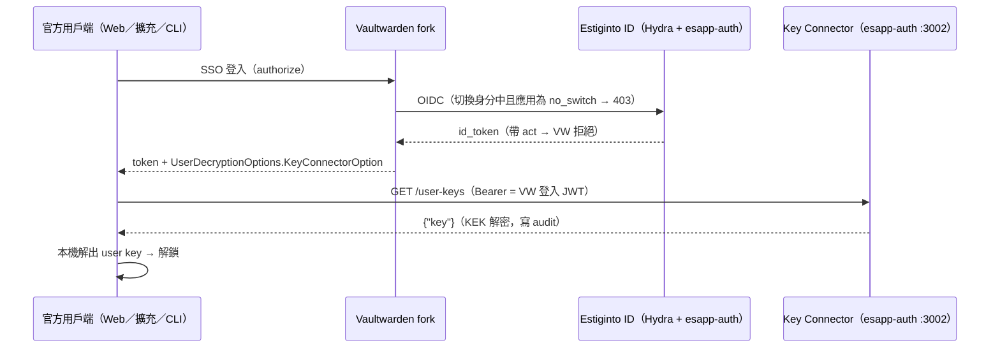

# Vaultwarden fork + Key Connector 驗證報告

日期：2026-11-26（Asia/Taipei）。對象：hc `t43`。

目標：一般成員用 Estiginto ID（Ory）登入 Vaultwarden 後，不需主密碼就能解鎖，金鑰由組織集中保管，也就是 Bitwarden 官方 Key Connector 模式。官方 Web vault、Chrome 擴充與 bw CLI 都不需修改。擁有者與管理員仍使用主密碼。

**結論：全部驗證項目都通過。** Web vault、官方 Chrome 擴充 2026.11.0、bw CLI 2026.11.1（SSO 與 API key 兩種登入）都已實測：成員不必輸入主密碼即可解鎖。擁有者仍需要主密碼，也無法改用 Key Connector。管理員切換成其他成員時，Hydra 與 Vaultwarden 兩層都會拒絕登入，因此拿不到該成員的金鑰。

> **2026-11-27 變更**：使用者決定允許切換身分登入 Vault（密碼庫為組織共用）。VW 層拒絕帶 `act` 的 id_token 的檢查（下表 #12）已移除，esapp-auth 的 `vault` 應用也關掉 `no_switch`（#11）；管理員切換成成員後可登入並取得該成員的 KC 金鑰。KC 對帶 `act` 的 VW token 仍拒絕（#13），但 VW 簽發的 token 不帶 `act`，不影響此流程。
>
> **2026-11-27 自動加入（JIT）**：有 KC 組織時，SSO 新使用者不需邀請，第一次登入即建帳並以 User、Invited 加入 KC 組織（`key_connector::auto_join_key_connector_org`，`identity.rs` 的 SSO 註冊在沒設網域白名單時也放行）；之後流程同 #3。已實測於正式環境（臨時身分，驗完已刪）。

## 1. 交付物

| 項目 | 位置 |
|---|---|
| Vaultwarden fork | [`mics8128/vaultwarden`](https://github.com/mics8128/vaultwarden)（公開）的 `esapp/key-connector` 分支（已設為預設分支）。內容是 tag `1.37.5`，加上 PR [#7419](https://github.com/dani-garcia/vaultwarden/pull/7419) 的 8 個 commit（到 `6fceabef`），再加上 `a1c70b3d`（把 Key Connector 改成組織 SSO 設定，並與官方對齊）和 `d13a1de6`（CI）。 |
| 映像 | `ghcr.io/mics8128/vaultwarden:1.37.5-esapp.10`（amd64，公開，可匿名 pull）；浮動 tag 為 `esapp-key-connector`。版本號格式：`<上游 tag>-esapp.<上游 tag 之後的 commit 數>`。 |
| CI | `esapp-image.yml`：push 時建置並推送映像。`esapp-upstream-sync.yml`：每天 19:17 UTC 偵測上游 release，接著 rebase、執行 fmt／clippy／test（sqlite、mysql、postgresql），再推送分支與 tag、開 PR 並建置映像；遇到衝突或失敗時開 issue。上游 `build.yml` 也已在這個分支通過。sync 已手動觸發一次，結果為「on 1.37.5, upstream 1.37.5」並略過（[run](https://github.com/mics8128/vaultwarden/actions/runs/45673892406)）。上游目前沒有更新的 release，所以 rebase、PR、issue 這幾條路徑會在下一次上游 release 時才第一次實際執行。 |
| Key Connector | 私有倉庫 `mics8128/esapp-auth`，分支 `feature/key-connector`（`6ac95e3`）。主要程式在 `internal/keyconnector`，設定 `KC_LISTEN` 時才啟動另一個 listener。這個分支尚未 merge 到 main，也未部署到 VM131。 |
| 切換身分防護 | 同一個分支：`clients.json` 的應用欄位 `no_switch`，對應後台「切換身分時不能登入（只限本人，例如密碼庫）」。 |
| 臨時驗證環境 | pve-1 VM140 `vw-kc-test`（`192.168.0.155`），2026-11-27 已刪除（`qm destroy 140 --purge`），`/opt/kctest` 的測試資料一併移除。 |

## 2. 驗證結果

環境：VM140 上自行建立一整套臨時服務，包括 Postgres、Kratos v26.2.0、Hydra v26.2.0、Caddy，以及用 `feature/key-connector` 建置的 esapp-auth（KC 走 `:3002`）。Vaultwarden 使用 `1.37.5-esapp.10`、SQLite，內建 Web vault 2026.10.1。另外開了 3 條 trycloudflare quick tunnel，分別給 auth、vault、kc。測試身分是 `kc-owner`（`admins` 群組）與 `kc-member`。整個測試沒有使用正式的 Ory、`clients.json` 或 VM131。

| # | 項目 | 用戶端 | 預期 | 結果 | 證據 |
|---|---|---|---|---|---|
| 1 | 設定驗證 | `/admin` | 未開 Require SSO，或 URL 不在 `ALLOWED_CONNECT_SRC` 時拒絕 | ✅ | 回 400：`Key Connector requires the Require Single Sign-On Authentication policy to be enabled.`；URL 錯誤時回 `Add https://evil.example to ALLOWED_CONNECT_SRC …` |
| 2 | 組織 SSO 設定 | `/admin` → Organizations | 設定 Key Connector、URL 與 Require SSO，並顯示目前狀態 | ✅ | `organizations.member_decryption_type=1`，`org_policies` 中 type 3（Single org）與 type 4（Require SSO）都已啟用；頁面顯示「Key Connector: active」 |
| 3 | 新成員首次登入 | Web vault | 出現官方「驗證您的組織以登入」頁，不要求設定主密碼 | ✅ | `GET confirmation-details` 200 → `POST KC/user-keys` 200 → `POST set-key-connector-key` 200；DB 中 `password_hash` 為空、`uses_key_connector=1`，邀請自動變成 Accepted |
| 4 | 再次登入 | Web vault | SSO 後直接解鎖 | ✅ | `GET KC/user-keys` 200（client `web`），沒有主密碼畫面 |
| 5 | API key 登入 | bw CLI 2026.11.1 | `login --apikey` 直接得到 session，不需要 `bw unlock` | ✅ | token 回應包含 `ApiUseKeyConnector:true` 與 `KeyConnectorOption`；`bw login --apikey --raw` 取得 session，`status` 為 unlocked，也能建立和列出項目；KC audit client 為 `user.<uuid>` |
| 6 | SSO 登入 | bw CLI | `login --sso` 直接解鎖 | ✅ | 瀏覽器回到 `localhost:8065` 後顯示「Successfully authenticated」；`status` 為 unlocked；KC audit client 為 `cli` |
| 7 | CLI lock | bw CLI | 依官方行為，KC 使用者無法 lock，改為登出 | ✅ | `You cannot lock your vault because you are using Key Connector … logged out` |
| 8 | SSO 登入 | 官方 Chrome 擴充 `bit-dist-chrome-2026.11.0` | 設定自架 URL 後用 SSO 解鎖 | ✅（見註） | `POST token` 200 → `GET KC/user-keys` 200（client `browser`）；擴充畫面顯示密碼庫與 CLI 建立的項目 |
| 9 | 擁有者／管理員 | Web vault、API | 仍需要主密碼，不能使用 Key Connector | ✅ | 重新整理後出現主密碼解鎖畫面；token 回應為 `HasMasterPassword:true`，沒有 `KeyConnectorOption`；`convert-to-key-connector` 回 `Cannot use Key Connector`；用擁有者自己的 token 查 KC 回 404 |
| 10 | 已有 KC 成員時停用 | `/admin` | 拒絕 | ✅ | `Key Connector cannot be disabled at this moment.` |
| 11 | 切換身分後登入 vault（Hydra 層） | Web vault | `no_switch` 應用回 403 | ✅ | esapp-auth 顯示「切換身分中：切換身分時不能登入 Vault (KC test)，這個服務只限本人使用。」並提供「返回我的帳號」；log 記錄 `switched sign-in refused` |
| 12 | 切換身分後登入 vault（VW 層） | Web vault | 暫時關閉 `no_switch` 時，VW 拒絕帶 `act` 的 id_token | ✅ | `POST /identity/connect/token` 回 400：`Signing in on behalf of another user is not allowed`；KC audit 沒有這次存取 |
| 13 | KC 拒絕代理 token | 單元測試 | 帶 `act` 的 token 回 403，任何 token 都只能讀取本人的金鑰 | ✅ | `TestRefusedTokens`、`TestUserKeysFollowTheOfficialContract`。VW 簽發的 token 不帶 `act`，所以這層只用單元測試驗證 |
| 14 | KC 存取紀錄 | — | 每次存取 `/user-keys` 都要先寫 audit；寫入失敗時拒絕回應 | ✅ | `kc/audit.log` 記錄 7 次存取（1 次 POST、5 次 GET 200、1 次擁有者 404），欄位包含 `time`、`user`、`client`、`device`、`ip`、`method`、`status`、`result` |
| 15 | 靜態檢查 | — | 全部通過 | ✅ | VW：`cargo fmt`、`cargo clippy --features sqlite,postgresql --all-targets` 無警告，`cargo test --features sqlite` 39 passed，CI 的 `Build` 通過（含 mysql／postgresql）。esapp-auth：`gofmt`、`go vet ./...`、`go test ./...` 全部通過 |

註（#8）：擴充測試使用 Playwright 的 Chromium，headless，載入官方 Chrome 擴充 zip，因此不是使用者自己的 Chrome。擴充收到 SSO code 後，背景程式會用 `chrome.windows.create` 開一個 popout 視窗，網址是 `popup/index.html#/sso?code&state`。headless Chromium 不會建立這種視窗，所以測試時改在原本分頁打開同一個網址；後續 token 交換與 KC 解鎖都由擴充本身完成。另外需要使用一般 Chrome 的 User-Agent；如果使用 HeadlessChrome UA，擴充會判斷成 Safari 而卡住。正式上線前建議在真正的 Chrome 再點一次，預計只需 1 分鐘。

## 3. 與官方差異表

官方行為依據 `bitwarden/server`、`bitwarden/key-connector`、`bitwarden/clients` 的原始碼，以及官方說明文件〈About Key Connector〉、〈Key Connector impact〉。

| 項目 | 官方 | 我們 | 原因 |
|---|---|---|---|
| 設定位置 | Admin Console → Single sign-on →「Member decryption options」 | Vaultwarden `/admin` → Organizations →「SSO / Key Connector」欄 | OSS web vault 沒有 SSO 設定頁，這是 Enterprise 功能，Vaultwarden 會隱藏 |
| 資料模型 | `SsoConfig.Data.MemberDecryptionType` + `KeyConnectorUrl`（組織層級） | `organizations.member_decryption_type`、`key_connector_url` 兩個新欄位（組織層級），數值相同：0=MasterPassword、1=KeyConnector | Vaultwarden 沒有 `sso_config` 表；只新增欄位，不改既有欄位 |
| env | 不需要 | 只有一個總開關 `KEY_CONNECTOR_ENABLED`；URL 必須列在 `ALLOWED_CONNECT_SRC` | 依 t43 要求，env 只放必要開關；CSP 使用 Vaultwarden 既有設定，儲存時會檢查 |
| Require SSO 政策 | 在 web vault 的政策頁設定，只有 `useSso` 組織會顯示 | 在 `/admin` 同一欄勾選後寫入 `OrgPolicy` type 4；執行規則與官方相同，非擁有者／管理員不能用密碼登入 | Vaultwarden 回報 `useSso=false`，web vault 不會顯示這個政策 |
| 啟用前提 | 必須開 Single org 與 Require SSO | 相同；組織啟用 KC 時，也不能關閉這兩個政策 | — |
| 擁有者／管理員 | 仍會提供 `KeyConnectorOption`，但 convert／set-key 會因授權檢查失敗而拒絕（`Cannot use Key Connector`） | 不提供 `KeyConnectorOption`，所以擁有者／管理員一律使用主密碼；後端仍會拒絕 convert／set-key，錯誤字串與官方相同 | 避免用戶端走到一定失敗的流程；原 PR 的 `KEY_CONNECTOR_EXEMPT_ADMINS` 已移除，豁免固定啟用 |
| `KeyConnectorOption` 何時出現 | 只出現在 SSO 登入 | 包含 SSO，以及已使用 KC 的成員以 API key 登入 | 讓 `bw login --apikey` 可以直接解鎖。`ApiUseKeyConnector:true` 也照官方回傳 |
| set-key-connector-key | V1（`key`、`keys`、`kdf*`、`orgIdentifier`）與 V2（signing keys） | 只支援 V1 | V2 需要 Vaultwarden 沒有的 signing keys；用戶端只有在 feature flag 開啟時才會送 V2，而 Vaultwarden 不會開啟這個 flag |
| `sso-jit-provision-finish` 等新 JIT 端點 | 有 | 沒有 | 用戶端只有在 feature flag 開啟時才使用；目前的 V1 流程已實測可用 |
| SSO identifier | 組織的 SSO identifier | Vaultwarden 慣例：`00000000-01DC-01DC-01DC-000000000000` 或組織 UUID。Web vault 用 email 登入時會自動填入；CLI／擴充的 SSO 頁面需要手動輸入，登入時任何字串都可以 | Vaultwarden 沒有組織 identifier。新成員**第一次**必須從 Web vault 登入，這次已驗證；CLI 或擴充用自訂 identifier 執行首次 set-key 會找不到組織 |
| 每台伺服器的 KC 組織數 | 每個組織各自設定 | 最多 1 個 | 用 FAKE identifier 找組織時需要結果唯一；Single org 政策下這個限制不影響使用 |
| 存放與加密 | 支援多種資料庫；金鑰可放在 HSM、Azure Key Vault、HashiCorp Vault，或檔案系統 RSA | JSON 檔原子寫入，使用 AES-256-GCM，AAD 綁定 user id；KEK 從 `.env` 讀取 | 只有單一實例，採最小實作；記錄被複製到其他 user id 時無法解密 |
| 存取紀錄 | 只有 `LastAccessDate` | 每次存取 `/user-keys` 都寫一行 JSON，寫入失敗時回 500，不交出金鑰 | 依 brief 要求；同時保留 `LastAccessDate` 欄位 |
| JWT 驗證 | JwtBearer 使用 Authority（Identity）、`ValidateAudience=false`；policy 要求 `amr∈{Application,external}` 且 `scope=api` | 依 Vaultwarden discovery／JWKS 驗證 RS256，並檢查 iss、exp、nbf、`amr`、`scope`，`sub` 必須是 GUID | 相同。**aud 不驗證**，因為 Vaultwarden 的 login JWT 沒有 `aud`，官方也關閉這項檢查 |
| 時鐘誤差 | ASP.NET 預設 5 分鐘 | 30 秒 | 縮短寬限時間；同主機與 NTP 環境不需要 5 分鐘 |
| 代理登入（`act`） | Bitwarden 沒有代管登入概念 | 三層拒絕：Hydra 的 `no_switch` 應用、VW 的 SSO `exchange_code`、KC 都拒絕帶 `act` 的 token | 防止管理員切換成成員後取得成員金鑰 |
| API 與狀態碼 | `GET /alive`、`GET /now`；`GET`、`POST`、`PUT /user-keys`，JSON 為 `{"key"}`；查無資料回 404，重複 POST 回 400；CORS 只允許 WebVault 並帶 credentials | 相同 | 官方用戶端不需修改即可使用，已實測 |
| 部署形態 | 獨立服務 | 放在 esapp-auth 程式內，但使用獨立 listener（`KC_LISTEN`）與獨立 hostname | 沿用既有 Go 服務與部署方式，不另外增加 .NET 服務 |
| 其他行為 | 離開組織、帳戶復原、緊急存取接管都會拒絕 | 相同，錯誤字串也與官方相同 | — |

## 4. 限制與風險

1. **不可逆**：成員改用 KC 後就沒有主密碼。組織中只要有 KC 成員，就無法停用 KC。若 KEK 或 `keys.json` 遺失，KC 成員的密碼庫將無法復原。KEK 必須離線備份，而且要與 `keys.json` 分開保存。
2. **schema**：fork 新增兩個欄位，並多出一筆上游沒有的 migration 紀錄。換回上游映像的行為未驗證；推測多出的欄位不會影響上游查詢，但組織的 KC 設定會被忽略，KC 成員也會無法解鎖。因此應視為無法降回上游。
3. **長期維護**：維護者已在 #6949 拒絕由伺服器端保管金鑰，#7419 不一定會被合併，因此 fork 需要長期自行維護。這個風險已由 CI 自動 rebase 降低（見第 6 節）。
4. **被移出組織的 KC 成員**：伺服器找不到他所屬的 KC 組織，因此不會提供 URL，用戶端也無法解鎖。官方行為相同，因為 KC 綁定組織。
5. 每台伺服器只能有 1 個 KC 組織；Require SSO 只能從 `/admin` 設定（見差異表）。
6. **新成員第一次登入**必須使用 Web vault。
7. **KC 成員查看自己的 API key**：用戶端會要求 email OTP，因為這類使用者沒有主密碼，所以正式環境必須設定 SMTP。測試環境沒有 SMTP，因此直接在 DB 寫入測試用 API key；測試結束後已清除。
8. **KEK 輪替尚未實作**：目前做法是用舊 KEK 解開、再用新 KEK 重新加密，需要另寫一次性工具。
9. 本機沒有 libpq，postgres／mysql 的測試只在 CI 執行；CI 的 `Build` 已通過。
10. `esapp-upstream-sync.yml` 只使用 schedule／dispatch 觸發。預設分支改成 `esapp/key-connector` 後，GitHub 不會自動登錄這個 workflow，必須等這個檔案在預設分支有新的 commit 才會登錄；目前已完成登錄。如果上游修改了 `.github/workflows`，`GITHUB_TOKEN` 無法 push 這些修改，需要設定 secret `ESAPP_SYNC_TOKEN`（fine-grained PAT，權限為 contents + workflows write）。
11. esapp-auth 的 `feature/key-connector` 從本機 main（`8bbf401`）分出來，所以 push 時一併帶上 main 尚未推送的 5 個 commit：Rakazo SCIM 相關 2 個、帳號 ID、移除 Vault／Gate／Rakazo、記住裝置。這 5 個 commit 與 KC 無關，origin/main 仍未更新。
12. 小問題：esapp-auth 拒絕前會先記一行 INFO `switched sign-in`，接著才記 WARN `refused`。

## 5. 正式上線計畫

正式 Vault（VM127）已在 2026-11-26 移除，所以上線等於重新建立服務。以下步驟都需要 t43 或使用者核准後才執行。

1. **esapp-auth**：審查後把 `feature/key-connector` merge 到 main，其中包含第 4 節第 11 項的 5 個 commit。部署前先備份 VM131 `/opt/ory/esapp-auth`。
2. **KC 設定（VM131）**：
   - 用 `openssl rand -base64 32` 產生 `KC_KEK`，放入 `/opt/ory/.env`（0600），並另外離線保存。
   - compose 的 `esapp-auth` 加上 `KC_LISTEN=:3002`、`KC_IDENTITY=https://vault.esapp.net`、`KC_WEB_VAULT=https://vault.esapp.net`、`KC_STORE=/kc/keys.json`、`KC_AUDIT=/kc/audit.log`。
   - 新增 volume `./kc:/kc`，owner 為 uid 65532，權限 0700。
   - 讓 `kc.esapp.net` 經 Caddy 或 tunnel ingress 轉到 `esapp-auth:3002`；DNS 需在 dashboard UI 新增。
   - `keys.json` 與 `audit.log` 納入備份。
3. **Vaultwarden VM**：
   - 從範本 9002 clone。
   - 映像固定使用 `ghcr.io/mics8128/vaultwarden:1.37.5-esapp.10`，不要使用浮動 tag；資料庫用 Postgres。
   - 設定 `SSO_ENABLED=true`、`SSO_SIGNUPS_MATCH_EMAIL=true`、`KEY_CONNECTOR_ENABLED=true`、`ALLOWED_CONNECT_SRC=https://kc.esapp.net`。
   - 設定 SMTP，讓 KC 成員可以收 OTP。
   - 使用 Argon2 格式的 `ADMIN_TOKEN`。
   - 不要開 `SSO_AUTH_ONLY_NOT_SESSION`。
   - 新增 tunnel 與 `vault` DNS。
4. **Ory**：
   - 建立 Hydra client `vaultwarden`，redirect 為 `https://vault.esapp.net/identity/connect/oidc-signin`。
   - 正式 `clients.json` 新增 `vault` 應用，設定 `no_switch:true` 並加上圖示。後台儲存時必須有圖示。
5. **組織**：
   - 擁有者先用 SSO 登入，自行設定主密碼。
   - 建立組織並開啟 Single org。
   - 到 `/admin` 設定 Key Connector、`https://kc.esapp.net` 與 Require SSO。
   - 邀請成員，並請成員第一次從 Web vault 登入。
6. **上線前驗收**：用真正的 Chrome 擴充點一次第 2 節 #8；重做 #9、#11、#12；確認 `audit.log` 有資料。
7. **回復**：在任何成員完成 KC 註冊之前，可以把 `/admin` 設回「Master password」，或直接撤掉服務。成員一旦完成註冊，就只能用 fork 與 KEK 繼續運作。

## 6. 維護方式

- **上游更新**：`esapp-upstream-sync.yml` 會每天檢查上游 release。若可順利 rebase，會產生分支 `esapp/rebase-<版本>`、tag `<版本>-esapp.<N>`、對應映像與 PR。PR **不要按 merge**；確認測試後依 PR 說明執行 `git push --force-with-lease origin esapp/rebase-<版本>:esapp/key-connector`，再關閉 PR。正式環境把映像 tag 改成新版本後重啟即可。若 rebase 衝突，或 checks／push 失敗，workflow 會開 issue，需要人工處理。
- **若 #7419 被上游合併**：比對上游 schema 與我們新增的兩個欄位，寫一次性 migration 把資料搬到上游欄位，然後丟掉 fork commit，改回上游映像。
- **用戶端變動**：留意 `bitwarden/clients` 中 KC 相關 feature flag（V2 set-key、JIT provision）。若 Vaultwarden 回報的版本讓用戶端預設走 V2，需要補後端端點。
- **esapp-auth KC**：程式只在 `internal/keyconnector`，另外 `main.go` 有一個接點；`go test ./internal/keyconnector` 已涵蓋官方 API 合約與拒絕規則。

## 7. 安全修正（2026-11-27，sec-fix-vault）

依據 `auth.esapp.net/reviews/security-opus-keys.md`（H2）、`security-opus-attacker.md`（L1）、`security-gemini-flash.md`（#3、#7、#8、#10、#18、#19、#23）。只做不改變使用流程的修正；映像 `1.37.5-esapp.<N>` 見部署紀錄。

| 項目 | 修正 | 原因 |
|---|---|---|
| KC 設定鎖定 | 組織已有 `uses_key_connector` 成員時，`/admin` 拒絕修改 KC URL 與 member decryption option（含停用）。官方 SSO 設定同樣會鎖住 | 改 URL 會讓既有成員把登入 token 送到新位址；停用會讓他們沒有主密碼 |
| KC 設定稽核 | `/admin` 每次儲存 SSO／KC 設定（含被拒絕的）都記事件（啟用 1606、停用 1607、其他 1600 `OrganizationUpdated`）並寫 WARN log（含來源 IP 與送出的設定） | 原本只有啟用或停用時記事件，改 URL 沒有紀錄。事件需要 `ORG_EVENTS_ENABLED=true`，VM142 已開，保留 365 天（`EVENTS_DAYS_RETAIN`） |
| `ALLOWED_CONNECT_SRC` | 只能由環境變數設定：`/admin` 不能修改；`data/config.json` 裡的值啟動時忽略並警告 | 它限制 KC URL 可用的位址；能從 `/admin` 改就能同時改 URL |
| KC URL | 必須是 https，http 只允許 loopback | 明文 KC URL 會曝露登入 token 與金鑰 |
| `convert-to-key-connector` | 先確認使用者是 KC 組織的 Accepted／Confirmed 成員，否則拒絕並保留主密碼 | 原本任何非管理員帳號都能丟掉主密碼 |
| 撤銷成員 | 已撤銷（revoked）的成員資格不再提供 KC 選項，也不能 set-key | 撤銷後不應再取得組織的 KC |
| 成員升為 Admin／Owner | 已用 KC 的成員被升級時寫 WARN log；事件沿用既有 `OrganizationUserUpdated`。**不阻擋**，是否阻擋由使用者決定 | 官方不允許管理員使用 KC |
| set-key-connector-key | 先檢查入組政策並接受邀請，再寫入帳號；通知信失敗只記 log，不回錯誤 | 原本帳號已標成 KC 後才檢查政策，失敗時使用者看到錯誤卻無法重試 |
| Require SSO 與續期 | 密碼登入的 refresh token 續期也套用組織的 Require SSO 政策（Owner／Admin 依官方例外） | 原本只看全域 `SSO_ONLY`，開政策前的密碼工作階段可一直續期 |
| 註冊 | 已有 KC 狀態、帳號金鑰或 user key 的紀錄不能再註冊 | KC 帳號沒有主密碼，原本會被當成未註冊而覆寫金鑰 |
| SSO 主體 | UserInfo 的 `sub` 必須等於 id token 的 `sub`（OIDC Core 5.3.2）；`email_verified` 只採用與該 email 同一來源的值 | 避免把另一來源的驗證狀態套到別的地址 |
| SSO PKCE 與兌換 | 一律驗本機 PKCE challenge（即使上游也驗）；兌換時刪除 SSO auth 必須剛好刪到一筆，否則拒絕 | 不依賴 IdP 是否真的強制 PKCE；同一筆兌換資料只能產生一個工作階段 |
| `rsa_key.pem` | VM142 改成 0600（內容不變，JWKS 不變） | 它簽 Vaultwarden 登入 JWT，KC 依此信任 |

未做（等使用者決定）：個人 API key 登入的 KC 解鎖、拒絕 `act`、Agent JIT、已是 KC 成員的 Admin 處理方式。限制：set-key 失敗重試時，KC 端可能已存有金鑰（重複 POST 回 400），這屬於 esapp-auth 的範圍。

## 8. 驗收後修補（2026-11-27，secverify，映像 `1.37.5-esapp.28`）

依據 `auth.esapp.net/reviews/security-astra-verify.md`。

| 項目 | 修正 | 原因 |
|---|---|---|
| 撤銷判斷（A-H3／G8） | 撤銷是「原狀態 −128」（`Membership::revoke`），不是固定的 −1。KC 相關判斷統一成兩個函式：`revoked`（status < Invited）與 `active_member`（status ≥ Accepted）。上游 `find_main_org_user_email`、`find_org_user_email`、`find_main_user_org` 的 `!= Revoked` 也一併改成 `>= Invited`。測試用 `Membership::revoke()` 產生的實際值 | 第 7 節只排除 −1，實際撤銷的成員（−126～−128）仍會拿到 KC |
| `esapp_sub` claim | VW 簽發的 access token（登入、續期、個人 API key）只在使用者是 KC 組織的有效成員（Accepted／Confirmed、未撤銷）時，才帶 `esapp_sub`＝`sso_users.identifier` 的 subject（Ory identity id，不可變）。KC 改用它查 Kratos（esapp-auth 端另行上線） | KC 原本以 email 查身分；email 可變，也無法反映 VW 的撤銷 |
| 轉成 KC（A-H4／G2） | `convert-to-key-connector` 與 `key-connector/enroll`：(1) token 必須是 5 分鐘內登入取得的（新 claim `auth_time`，只在實際登入時寫入，續期取得的 token 沒有）；(2) VW 用使用者自己的 token 對 KC 送 `GET /user-keys`，確認 KC 已存有金鑰；兩項都通過才清掉主密碼，否則保留 | 官方用戶端在 SSO 登入後立刻轉換，使用流程不變；外洩或續期得到的工作階段無法丟掉主密碼，KC 沒存好也不會讓帳號無法解鎖 |
| 註冊原子化（G7） | 既有紀錄改用單一條件式 `UPDATE ... WHERE` 未初始化（沒有密碼、未用 KC、沒有帳號金鑰、沒有 user key）；影響 0 列就拒絕 | 原本先讀再寫，中間可能被別的設定流程寫入 |

**撤銷延遲**：VW 撤銷成員後，已發出的 access token 仍帶 `esapp_sub`，最長到該 token 到期：SSO 登入的 token 跟隨 IdP（Hydra）access token 效期（目前 1 小時），密碼／API key 登入為 2 小時。之後續期取得的 token 就沒有這個 claim。

限制：
- 轉換時 VW 會連 KC。KC 連不到時就拒絕轉換，主密碼保留，稍後可以再試。
- 條件式註冊只有 sqlite 在本機編譯；postgres／mysql 由 CI 編譯。DB 行為沒有自動測試。
